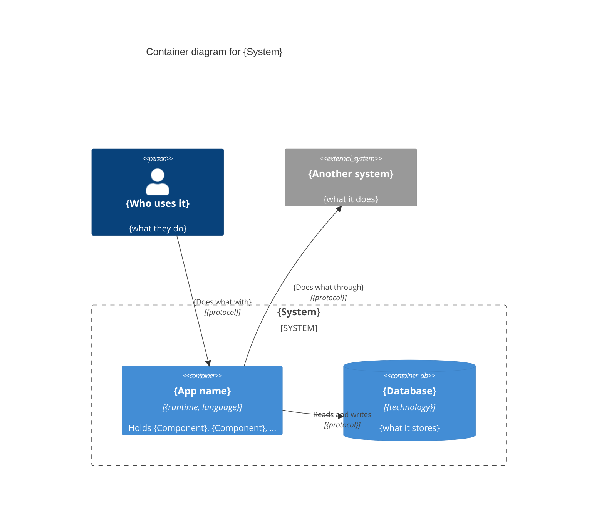
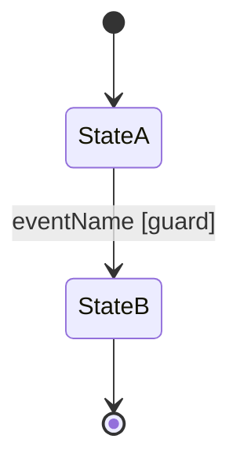
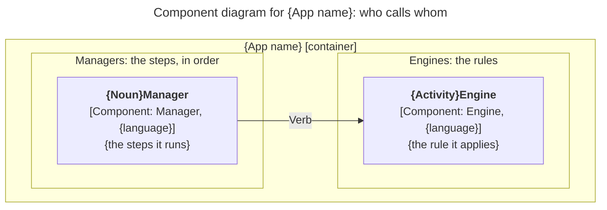

# {System name}: Agent System Design Document

**Source design:** `{name}.design.md` · **Language:** {TypeScript | Go | Rust} · **Status:** draft

## 1. Header & Boundary Box: what gets built, and what does not

**System:** {one line: what it does, for whom}
**Target mode:** {modular monolith | event-driven services | …} in {language}, {runtime}, {storage} *(assumed, if the design did not say)*

A C4 container diagram: what runs, and the components that each container holds (see
`c4.md`). If there is a single container, write "Everything runs in one container: {name}"
in place of the diagram.



Key: blue boxes run inside our system. Grey boxes are other systems. The figure is a
person. Each container lists the components that it holds.

### In scope

- {feature, in the user's words}

### Out of scope (non-goals)

- {rejected candidate, future change, or tempting side quest}

### Decisions carried from the design

- {an assumption of the design, as the design states it}

### Decisions added by this spec

Each item was open in the design, and this spec decides it. Review these items first.

- {decision}: {chosen value}. If wrong: {what changes}.

Open questions (a maximum of three) also appear inline, where they apply:
`[NEEDS CLARIFICATION: {the specific question}]`. Answer the open questions before an
agent builds the system.

### Words used here

Give one line for each technical word that this blueprint uses, in plain words (see
`writing-guidelines.md`). For example:

- **Invariant**: a rule that must always be true, in all conditions.
- **Idempotent**: safe to do two times. The second time changes nothing.
- **Encapsulates**: keeps a likely change inside one part, so the change does not touch
  the other parts.

## 2. System Invariants: rules that must always hold

1. **{Rule name}.** {One checkable sentence.} Enforced by `{Component.method}` {in the same
   transaction as {write}}. Violation: `{ERROR_CODE}`.
2. …

(Most systems have 4–7 invariants. A small domain can have fewer. Do not pad the list.
Cover idempotency, immutability, and the hard rejections, where they apply.)

## 3. Core Domain Data Contracts: the exact shape of the data

Conventions:

- {IDs are branded strings, so code cannot use one kind of ID in place of another kind.}
- {Money is a whole number of the smallest unit (cents), plus an ISO 4217 currency code.}
- {Times are ISO 8601 strings in UTC.}
- {A `?` marks a field that can be missing.}

```ts
// Identifiers
export type {Thing}Id = string & { readonly __brand: "{Thing}Id" };

// Enumerations and states
export type {Thing}Status = "{a}" | "{b}" | "{c}";

// Records
export interface {Thing} {
  id: {Thing}Id;
  status: {Thing}Status;
  {optionalField}?: string;
}

// Errors
export type ErrorCode = "{ERROR_A}" | "{ERROR_B}";
export type Result<T> = { ok: true; value: T } | { ok: false; error: ErrorCode; detail?: string };
```

### Error catalog

Give one row for each code in `ErrorCode`. The fault column says who must fix the error.
The fault is the caller's (a 4xx status) when the caller sent something that the method
cannot accept. The fault is ours (a 5xx status) when our code broke its own promise. Over
HTTP, errors use RFC 9457 problem details (`application/problem+json`), with the code in a
`code` field.

| Code | Meaning | Fault | HTTP | Retry helps? |
|------|---------|-------|------|--------------|
| `{ERROR_A}` | {what went wrong} | caller | {409} | no |
| `{ERROR_B}` | {what went wrong} | supplier | {503} | yes, with backoff |

(If there is no HTTP boundary, remove the HTTP column.)

## 4. State Machines: how things move from one state to the next

### {Thing}Status



Stored by `{Component}`. The verb on each arrow does that transition, as a
compare-and-set. The system refuses each transition that is not drawn:
`{INVALID_TRANSITION}`. Terminal: {states, or "none"}. {If the design gives this machine a
different name: "This is the design's `{Machine}` machine."}

## 5. Module Boundaries & Interface Signatures: the parts and how to call them

### Module map

```
src/
  contracts/          types from section 3
  {component}/        one folder per component
tests/
  features/           the scenarios from section 6
```

### Component diagram

The component diagram of the design, drawn again inside its container, with the
technology added (`[Component: Manager, TypeScript]`). This diagram is necessary when there
are more than three parts.



Key: light blue, a component. Each arrow is a call, with the verb as its label.

### Entry points (Clients)

#### {Name}

- **Purpose:** {one line}
- **Encapsulates:** {who calls, and how}
- **Constraints:** {how callers prove who they are: a sign-in, an API key, a card and PIN}.
  No business rules.
- **May call:** {one Manager for each use case}

```ts
export interface {Name} {
  {entryPoint}(request: {Request}): Promise<{Response}>; // the design's entry points
}
```

- **Failure & retry:** {what the caller sees for each error, and if the caller can retry}
- **Internals:** {the bricks of the design for this part, in backticks, with the
  spelling of the design}

### Orchestration (Managers)

#### {Noun}Manager

- **Purpose:** {one line}
- **Encapsulates:** {the likely change it contains, in plain words}
- **Constraints:** runs the steps in order. No business rules.
- **May call:** {Engines, ResourceAccess, and Utilities. Other Managers only through a
  queue.}

```ts
export interface {Noun}Manager {
  {verb}(input: {Input}): Promise<Result<{Output}>>; // errors: {CODE_A}, {CODE_B}
}
```

- **Flow of `{verb}`:**
  1. `{Engine.verb}` …
  2. `{Access.verb}` …
  3. {Only if the design has one:} queue `{OtherManager.verb}` …
- **Failure & retry:** {retryable vs final errors, timeouts, idempotency on retry, races}
- **Internals:** {the bricks of the design for this part, in backticks, with the
  spelling of the design}

### Business rules (Engines)

#### {Activity}Engine

- **Purpose:** …
- **Encapsulates:** …
- **Constraints:** pure and in-memory: no network, storage, clock, or randomness. The
  Manager passes in what the Engine needs.
- **May call:** {Utilities. A read-only ResourceAccess, only if the design records one.}

```ts
export interface {Activity}Engine { … }
```

- **Failure & retry:** deterministic. Returns errors as values. No retries.
- **Internals:** {the bricks of the design for this part, in backticks, with the
  spelling of the design}

### Resource access (ResourceAccess)

#### {Noun}Access

- **Purpose:** …
- **Encapsulates:** {the vendor or storage that can change}
- **Constraints:** the only code that touches {vendor or storage}. Exposes business verbs,
  not CRUD or vendor types.
- **May call:** {Resources, Utilities}

```ts
export interface {Noun}Access { … }
```

- **Failure & retry:** {timeouts, which vendor errors are retried, backoff, idempotency key}
- **Internals:** {the bricks of the design for this part, in backticks, with the
  spelling of the design}

### Shared infrastructure (Utilities)

Give only a Utility that this system builds and that the design names. Off-the-shelf
logging gets only a folder in the module map.

#### {Utility}

- **Purpose:** …
- **May call:** nothing

```ts
export interface {Utility} { … }
```

- **Failure & retry:** …

## 6. Agent Verification Suite: tests that say when it is done

```gherkin
Feature: {capability}

  Scenario: {one behavior}
    Given {context with concrete values}
    When {one action}
    Then {observable outcome, with the error code where one applies}

  Scenario Outline: {a family of rejections}
    Given {context}
    When {action with <input>}
    Then the request is rejected with <code>

    Examples:
      | input | code |
      | {x}   | {ERROR_A} |
```

**Verify:** `{npm test -- tests/features}`

**Done when:** every scenario above passes (the scenarios fail before the work starts),
and every existing test still passes.
