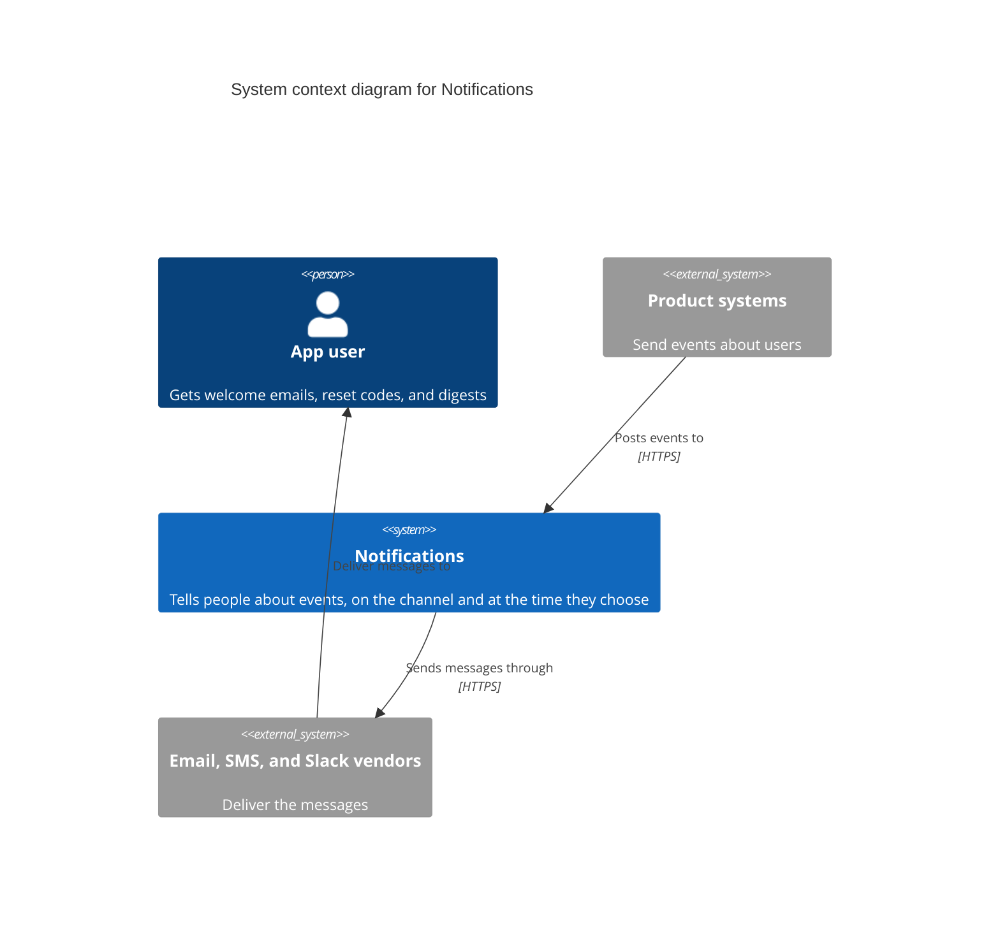
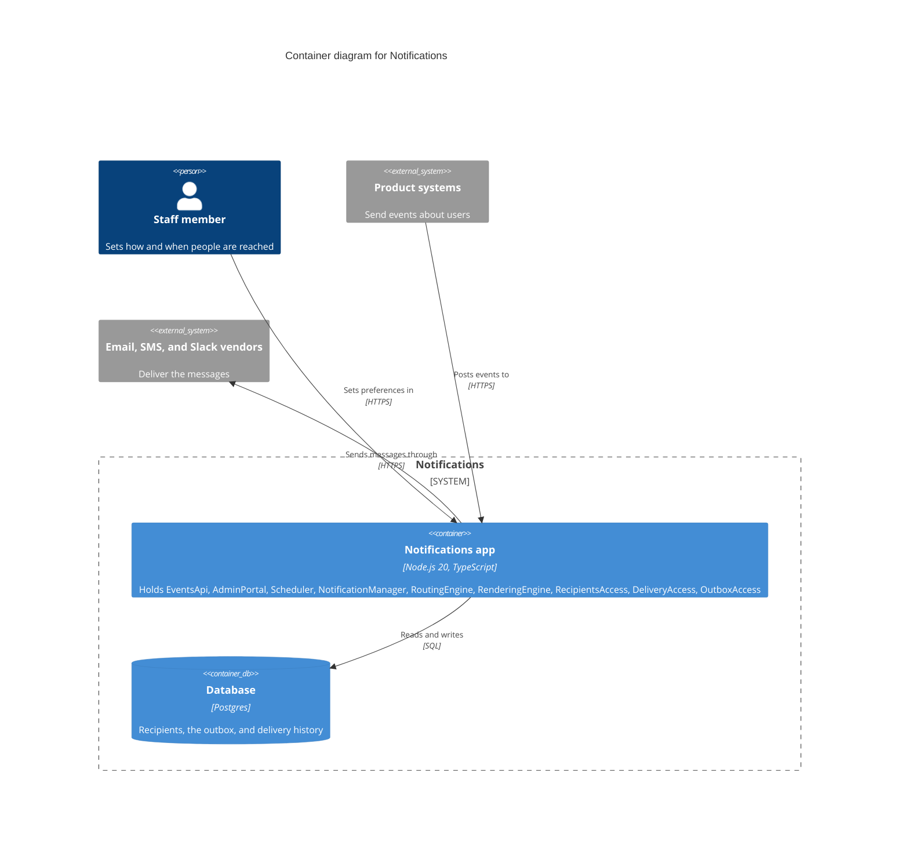
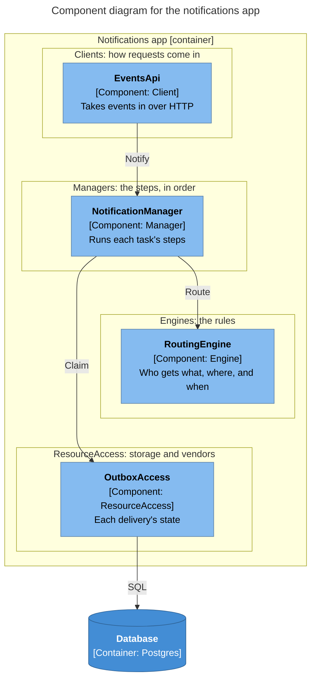

# C4 diagrams

The C4 model (Simon Brown, <https://c4model.com>) is a simple way to draw software at four
levels of zoom. `/decompose` and `/blueprint` use the C4 model to draw what they decide.
C4 does not decide anything itself. Volatility decides where the walls go, and C4 shows
the walls.

This guide ships with the two skills, so that the diagrams of the two skills match.

## The four levels, and who draws what

| C4 level | What it shows | Drawn by | Where |
|----------|---------------|----------|-------|
| 1. System context | the system as one box, the people who use it, and the other systems it talks to | `/decompose` | §1 Frame |
| 2. Container | the things that run: apps, databases, queues | `/blueprint` | section 1, under target mode |
| 3. Component | the parts inside a container, and who calls whom | both: `/decompose` in §4 Walls, `/blueprint` in section 5 | |
| 4. Code | classes and functions | nobody | C4 says generate it on demand or skip it |

C4's own terms, in plain words:

- **Person**: someone who uses the system.
- **Software system**: the thing that one team builds and owns.
- **Container**: something that must run so that the system works. Examples: a web app,
  a server app, a database, a queue, a file store, a serverless function. A container is
  not a Docker container. "Components are not separately deployable units … it's the
  container that's the deployable unit."
- **Component**: a group of related code behind one clear interface, inside a container.
  Managers, Engines, ResourceAccess parts, and Clients are components.

**Why `/decompose` stops at components.** The choice of containers is a deployment
decision. The same walls can run as one app (a modular monolith) or as several services.
Simon Brown calls "well-defined components in a monolithic application" "a stepping stone
to a microservices architecture." Thus, `/decompose` draws its components inside the
boundary of the system. `/blueprint` draws the components again, inside the container or
containers that it chooses.

**When to draw the component diagram.** C4 says: draw the diagram only when it adds
value. In these skills, the diagram usually adds value, because it shows the walls and
the call rules at a glance. A system with three parts or fewer can skip the diagram,
because the walls table says the same thing.

## Notation rules (from c4model.com)

1. **Give each diagram a title with its type and scope**: "System context diagram for
   Notifications", "Component diagram for the notifications app".
2. **Put a key under each diagram**, and start the key with `Key:`. Mermaid's C4 diagrams
   cannot draw a legend, so write the key in Markdown on the next line.
3. **Name the type of each element**: person, software system, container, or component.
4. **Give each element a short description** in plain words. Give each container and
   each component a technology. In `/decompose`, no technology is chosen yet, so write the
   kind of the part instead (`Manager`, `Engine`).
5. **Each arrow points one way, and has a label** that says what happens. The label
   matches the direction of the arrow: "Sends messages", not "Uses". An arrow between
   containers names the protocol (`HTTPS`, `SQL`).
6. **Draw each database, bucket, queue, or topic as its own container.** A queue that is
   only a table in the app's database is part of that database. Say so in the
   description of the database ("… and the notice queue"). Do not draw load balancers,
   replicas, or environments. They belong on a deployment diagram.
7. **One level and one scope in each diagram.** Do not mix containers and classes.
8. **Use the same names everywhere**: the diagram, the walls table, and the blueprint's
   section 5.
9. **Use plain words** for descriptions and labels (see `writing-guidelines.md`).
10. **When a person carries data between systems**, draw the two steps. For example, the
    student-records system gives a file to a librarian, and the librarian uploads the
    file:
    `Rel(sis, librarian, "Gives the term's student list to")` and
    `Rel(librarian, lib, "Uploads the student list to")`.

## How to write them in Markdown

Mermaid diagrams render on GitHub (GitHub bundles Mermaid 11.17). The C4 support of
Mermaid dates from Mermaid 9.1.2. Mermaid calls its C4 syntax experimental, and Mermaid
cannot route arrows around boxes. Thus, use these forms:

- **Context and container diagrams** (few boxes): Mermaid's C4 syntax.
- **Component diagrams** (many arrows): a Mermaid flowchart in C4 style, with one band
  for each layer. C4 is "notation independent", so this flowchart is still a C4 diagram.

### System context (Mermaid C4)



Key: the blue box is our system, grey boxes are other systems, and a figure is a person.
Arrows show who calls whom.

`Person` and `System` take `(alias, "label", "description")`. `Container` and `Component`
take `(alias, "label", "technology", "description")`. Mermaid places the boxes in the
order that you write them. Thus, write the boxes in the order that the arrows flow.
`UpdateLayoutConfig` changes the number of boxes in a row (see Checking, below).

### Container (Mermaid C4)



Key: the description of each container lists the components that the container holds,
so each component has a home. The dashed line is the boundary of the system.

### Component (C4-style flowchart)

````

````

- One `subgraph` for each layer, from top to bottom: Clients, Managers, Engines,
  ResourceAccess. `engines ~~~ access` is an invisible link that keeps Engines above
  ResourceAccess.
- Each box has `<b>Name</b>`, then `[Component: Kind]` (in `/blueprint`,
  `[Component: Kind, technology]`), then a plain description. The checker reads the name
  from the bold text.
- Each arrow is a call that the design lets a part make. The label of the arrow gives the
  verbs that the call uses.
- Do not draw Utilities, because all parts can call them. Say so in the key.
- In `/decompose`, the outer subgraph is the system (`Notifications [software system]`),
  because `/decompose` does not choose the containers. In `/blueprint`, the outer
  subgraph is the container.

## Checking

Render each diagram before you deliver the document. Mermaid's C4 syntax is
experimental. A diagram that does not render is worse than no diagram.

- `/blueprint`'s `check_blueprint.py --render` renders each Mermaid block with `mmdc`
  (Mermaid's command-line tool). The check fails if a block does not render.
- The C4 checks of `check_blueprint.py` also make sure of three things:
  - The component diagram names exactly the components of section 5.
  - Each arrow obeys the call rules.
  - Each component is in a container.
- If you do not have `mmdc`, paste the diagram into <https://mermaid.live>, and look at
  the diagram.

A render proves the syntax, not the layout. Open each picture and look at it. If labels
overlap or are not complete, do these steps:

- Write the elements in the order that the arrows flow. Mermaid places the elements in
  that order.
- Put the outside systems that the system calls after the boundary. Put the callers
  before the boundary.
- Make the labels shorter, and move the details into the description.
- Set `UpdateLayoutConfig($c4ShapeInRow="3", $c4BoundaryInRow="1")` to change the rows.
