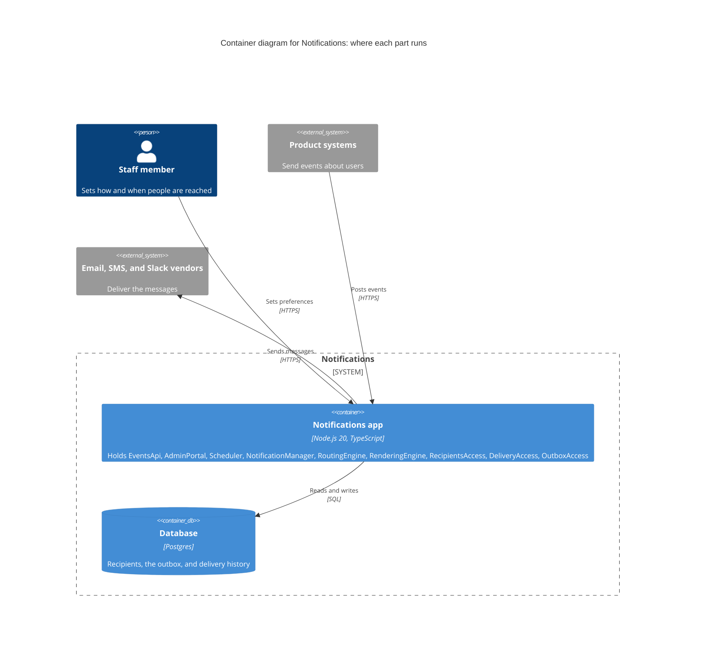
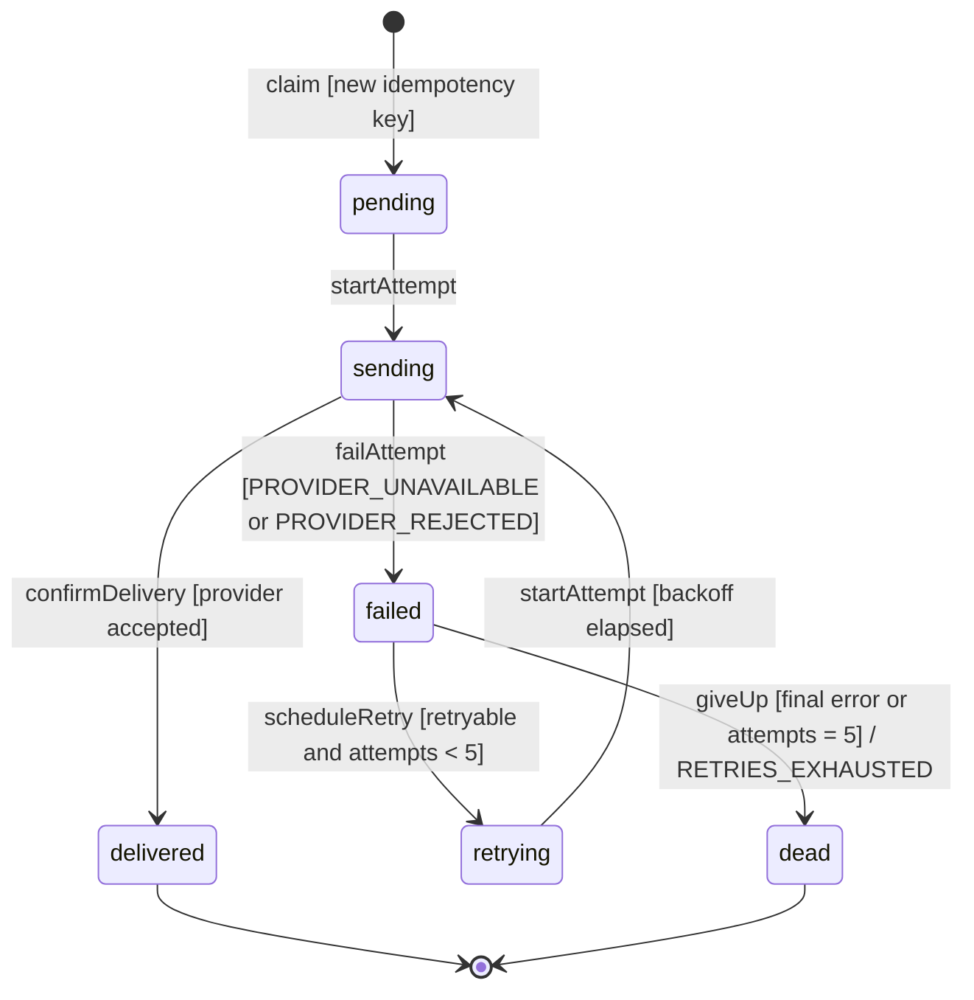
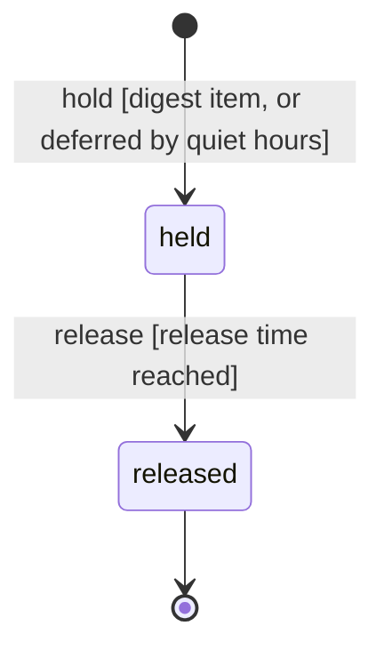
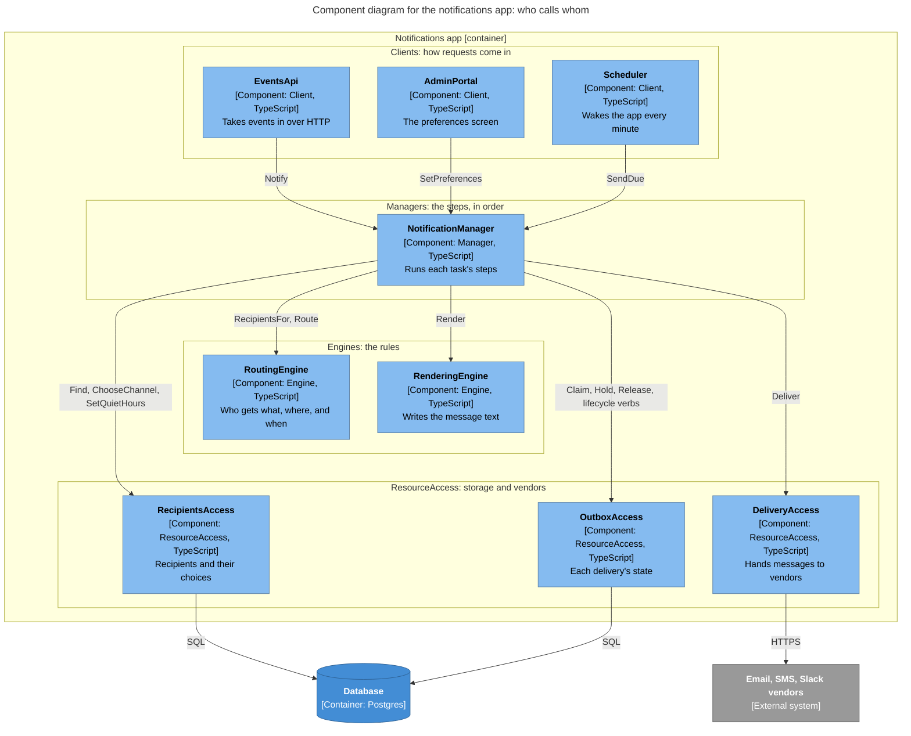

# Notifications: Agent System Design Document

**Source design:** `notifications.design.md` (the worked example in `decompose/references/examples.md`)
· **Language:** TypeScript · **Status:** draft

## 1. Header & Boundary Box: what gets built, and what doesn't

**System:** tells persons when something occurs in a different system. The system sends
email, SMS, or Slack messages. Each message goes in the language of the person, on the
channel and at the time that the person selects.
**Target mode:** one app in TypeScript on Node.js 20, with a Postgres database
*(assumed)*. A timer in the app wakes the app each minute.



Key: the blue boxes run in our system. The grey boxes are other systems. The figure is a
person. Each container names the components that it holds. The arrows show who calls
whom, and how.

### In scope

- A welcome email when someone signs up.
- A password-reset code by SMS.
- A daily email with a summary of what occurred (the digest).
- Alerts for the operations team, posted to Slack.
- Each person selects the channel that they prefer.
- Quiet hours: at night, the app does not send a message that can wait.
- If the app cannot send a message, the app tries again.
- Messages in the language of each person.

### Out of scope (non-goals)

- New channels (WhatsApp, webhooks), an opt-out, "send a text if the email isn't read",
  and a move of the recipient data to a different system. The design has room for each
  of these items. Do not build these items now.
- Marketing campaigns, A/B tests, and analytics.
- A template editor. The templates ship as files in `RenderingEngine`.
- Fax, and all other items that the design rejected.

### Decisions added by this spec

The design left each decision below open, so this spec makes each decision. Examine these
decisions first.

- Storage is one Postgres database. If wrong: only the ResourceAccess parts change.
- Each message has the key `eventId:recipientId:channel`. The app keeps each key for 30
  days. If wrong: `OutboxAccess.claim` changes.
- The urgent events are `password.reset` and `alert.*`. All other events can wait. If
  wrong: one table in `RoutingEngine` changes.
- Quiet hours are 22:00 to 07:00 in the time zone of the person, unless the person selects
  different hours. If wrong: one default changes.
- Try to send a maximum of 5 times. Wait 30 s, then wait longer each time, up to 1 h,
  plus a random part. If wrong: three numbers in `NotificationManager` change.
- If a message has no text in the language of the person, use English (`en`). If wrong:
  one default in `RenderingEngine` changes.
- The app sends the digest at 08:00 in the time zone of each person. If wrong: one number
  in `Scheduler` changes.
- A call to a vendor stops after 10 s. Change this limit when we know how fast the
  vendors are. If wrong: one number for each channel in `DeliveryAccess` changes.
- Times are ISO 8601 strings in UTC. If wrong: the `Instant` type changes.
- Each product system proves who it is with its own API key. If wrong: only `EventsApi`
  changes.
- Staff sign in with the company's sign-in. If wrong: only `AdminPortal` changes.

### Words used here

- **Client, Manager, Engine, ResourceAccess**: the four types of part. A Client receives
  requests. A Manager runs the steps of a task in order. An Engine applies rules. A
  ResourceAccess part connects to storage or to an external service.
- **Envelope**: the record that holds one message while the message goes through the
  steps.
- **Outbox**: the table that keeps each message and its current state.
- **Invariant**: a rule that must always be true.
- **Idempotent, idempotency**: safe to do two times. The second time changes nothing.
- **Atomic, atomically**: all or nothing. Nothing stays half done.
- **Compare-and-set**: change a value only if the value is the one that you expect. If
  someone changed the value first, refuse the change.
- **Backoff**: a wait that becomes a little longer after each failed try.
- **Jitter**: a random extra wait, so that many tries do not all occur at the same time.
- **Deterministic**: always gives the same answer for the same input.
- **Precondition**: something that must be true before a step can run.
- **Postcondition**: something that a step promises is true when the step finishes.
- **Payload**: the data sent with a request.
- **Latency**: the time that something takes to answer.
- **Orchestration**: the work to run the steps of a task in the correct order.
- **Encapsulates**: keeps a likely change in one part, so that the other parts do not
  notice the change.

## 2. System Invariants: rules that must always hold

1. **Each message is sent at most one time.** The key of a message is
   `eventId:recipientId:channel` *(assumed)*. If the same event comes again, the app
   returns the first result and sends nothing new. If the event comes again with
   different data, the app refuses the event. Enforced by `OutboxAccess.claim`, in the
   same database transaction that saves the message. Violation: `IDEMPOTENCY_CONFLICT`.
2. **Nothing that can wait is sent during quiet hours.** The app holds a message that can
   wait, and sends the message when quiet hours end. Enforced by `RoutingEngine.route`,
   which answers "wait until then". Reason: `QUIET_HOURS_DEFERRED`.
3. **Each message goes to a channel that the person accepts, or the app refuses the message.**
   The app does not quietly drop a message. Enforced by `RoutingEngine.route`. Violation:
   `NO_REACHABLE_CHANNEL`.
4. **A delivery only moves forward.** After a delivery is `delivered` or `dead`, the
   delivery does not change again. Enforced by `OutboxAccess`'s lifecycle verbs
   (`startAttempt`, `failAttempt`, `scheduleRetry`, `giveUp`, `confirmDelivery`). Each
   verb is a compare-and-set on the current state. Violation: `INVALID_TRANSITION`.
5. **Tries are limited.** After 5 failed tries *(assumed)*, the app marks the delivery
   `dead` and reports the delivery. The app does not try the delivery again. Enforced by
   `NotificationManager`, which uses the delivery state machine. Outcome:
   `RETRIES_EXHAUSTED`.
6. **No message goes out without its text.** Rendering makes the full message, or
   rendering fails. Rendering can use English as a fallback. Enforced by
   `RenderingEngine.render`. Violation: `TEMPLATE_NOT_FOUND`.

## 3. Core Domain Data Contracts: the exact shape of the data

**How the types work:** each kind of ID has its own type, so that the code cannot use one
kind of ID in place of a different kind. Times are ISO 8601 strings in UTC *(assumed)*. A
`?` marks a field that can be missing. Errors come back as values. One part does not
throw an error to a different part.

```ts
// Identifiers
export type EventId = string & { readonly __brand: "EventId" };
export type RecipientId = string & { readonly __brand: "RecipientId" };
export type DeliveryId = string & { readonly __brand: "DeliveryId" };
export type IdempotencyKey = string & { readonly __brand: "IdempotencyKey" }; // eventId:recipientId:channel
export type Instant = string & { readonly __brand: "Instant" };               // ISO 8601, UTC

// Enumerations
export type Channel = "email" | "sms" | "slack";
export type Urgency = "urgent" | "normal";
export type Locale = string; // BCP 47, e.g. "en", "de-CH"

// What other systems send in
export interface IncomingEvent {
  id: EventId;
  type: string;                     // e.g. "user.created", "password.reset", "alert.disk"
  occurredAt: Instant;
  subjectId?: RecipientId;          // the person the event is about, if any
  data: Record<string, string>;     // template variables
}

// The shared contract every brick passes along
export interface Envelope {
  eventId: EventId;
  eventType: string;
  recipientId: RecipientId;
  urgency: Urgency;
  channel?: Channel;                // set by routing
  locale?: Locale;                  // set by routing
  body?: RenderedMessage;           // set by rendering
  data: Record<string, string>;
}

export interface RenderedMessage {
  subject?: string;                 // email only
  text: string;
  locale: Locale;                   // the locale actually used, after fallback
}

export interface Recipient {
  id: RecipientId;
  timeZone: string;                 // IANA, e.g. "Pacific/Auckland"
  locale: Locale;
  preferredChannels: Channel[];     // in order of preference; may be empty
  contacts: Partial<Record<Channel, string>>;
  quietHours?: { start: string; end: string }; // "22:00", "07:00" local
}

export type RoutingDecision =
  | { kind: "deliver"; envelopes: Envelope[] }
  | { kind: "defer"; until: Instant; reason: "QUIET_HOURS_DEFERRED"; envelopes: Envelope[] }
  | { kind: "reject"; error: "NO_REACHABLE_CHANNEL" };

// Delivery lifecycle
export type DeliveryStatus = "pending" | "sending" | "delivered" | "failed" | "retrying" | "dead";

export interface DeliveryRecord {
  id: DeliveryId;
  key: IdempotencyKey;
  envelope: Envelope;
  status: DeliveryStatus;
  attempts: number;                 // 0..5
  nextAttemptAt?: Instant;          // set while retrying
  receipt?: Receipt;                // set when delivered
  lastError?: ErrorCode;
}

export interface Receipt {
  channel: Channel;
  providerMessageId: string;
  acceptedAt: Instant;
}

// Digest items waiting for their scheduled release
export type HeldItemState = "held" | "released";

// Errors
export type ErrorCode =
  | "IDEMPOTENCY_CONFLICT"
  | "QUIET_HOURS_DEFERRED"
  | "NO_REACHABLE_CHANNEL"
  | "INVALID_TRANSITION"
  | "RETRIES_EXHAUSTED"
  | "TEMPLATE_NOT_FOUND"
  | "PROVIDER_REJECTED"            // the vendor refused the message: final
  | "PROVIDER_UNAVAILABLE"         // timeout, 429, or 5xx from the vendor: retryable
  | "RECIPIENT_NOT_FOUND";

export type Result<T> = { ok: true; value: T } | { ok: false; error: ErrorCode; detail?: string };
```

### Error catalog

The Fault column shows whose fault each error is. If the caller broke a precondition, the
caller is at fault (a 4xx status). If our code broke a promise, we are at fault (a 5xx
status). Over HTTP, errors use RFC 9457 problem details, with the code in a `code` field.

| Code | Meaning | Fault | HTTP | Retry helps? |
|------|---------|-------|------|--------------|
| `IDEMPOTENCY_CONFLICT` | the same event ID came again with a different payload | caller | 409 | no |
| `QUIET_HOURS_DEFERRED` | not an error: routing held the message until quiet hours end | — | 202 | — |
| `NO_REACHABLE_CHANNEL` | no allowed channel has a contact for the recipient | caller | 422 | no, until the recipient's data changes |
| `INVALID_TRANSITION` | a lifecycle verb was applied to a delivery in the wrong state (a broken precondition, often a lost race) | caller | 409 | no |
| `RETRIES_EXHAUSTED` | a delivery failed 5 times and is dead | supplier (vendor) | — (internal) | no |
| `TEMPLATE_NOT_FOUND` | no template exists for the event type | supplier | 500 | no, until a template ships |
| `PROVIDER_REJECTED` | the vendor refused the message | caller data or vendor | — (internal) | no |
| `PROVIDER_UNAVAILABLE` | the vendor timed out or answered 408, 429, or 5xx | vendor | — (internal) | yes, with backoff |
| `RECIPIENT_NOT_FOUND` | no recipient has that ID | caller | 404 | no |

## 4. State Machines: how things move from one state to the next

### DeliveryStatus



`OutboxAccess` stores the delivery status. The verb on each arrow makes that move, as a
compare-and-set. The app refuses each move that the diagram does not show, with
`INVALID_TRANSITION`. The final states are `delivered` and `dead`.

### HeldItemState



`OutboxAccess` stores the state of each held item. `release` moves all items that are
due, in one transaction. The app cannot hold a released item again: `INVALID_TRANSITION`.

## 5. Module Boundaries & Interface Signatures: the parts and how to call them

### Module map

```
src/
  contracts/                  section 3 types, shared by all modules
  entry/events-api/           EventsApi (HTTP)
  entry/admin-portal/         AdminPortal (HTTP)
  entry/scheduler/            Scheduler (in-process timer)
  notification-manager/       flows and the delivery state machine
  routing-engine/             routing policies: expand, prefer, quiet hours
  rendering-engine/           templates/ and render
  recipients-access/          recipient profiles and preferences
  delivery-access/            email, sms, slack transports
  outbox-access/              outbox, delivery records, held items
  infra/                      logging, secrets, pub/sub
tests/
  features/                   section 6 scenarios
```

### Component diagram

The diagram shows each part of the app, and who calls whom. Each band holds one layer.
Each arrow is a call that the design lets a part make. The label on each arrow is the
verb that the call uses.



Key: a light blue box is a component in the app. A dark blue box is the database. A grey
box is a different system. The bands go from top to bottom: Clients, Managers, Engines,
ResourceAccess. The arrows are calls, and the label on each arrow is the verb that the
call uses. The diagram does not show the Utilities (logging, secrets), because each part
can call the Utilities.

### Entry points (Clients)

#### EventsApi

- **Purpose:** receives events that other systems post over HTTP.
- **Encapsulates:** which systems send events, and how.
- **Constraints:** each product system proves who it is with its own API key *(assumed)*.
  EventsApi only validates and forwards events, and does no routing or rendering.
  EventsApi calls one Manager.
- **May call:** `NotificationManager`, infrastructure.

```ts
// POST /events  body: IncomingEvent  →  202 { accepted: number }
// errors: application/problem+json with a `code` member; status from the error catalog
export interface EventsApi {
  receive(event: IncomingEvent): Promise<Result<{ accepted: number }>>;
}
```

- **Failure & retry:** returns 202 after the app claims the deliveries of the event. A
  replay of the same event returns 202 with the same count. Callers can retry on a
  timeout or a 5xx status.
- **Internals:** `OnEvent(type)`, which parses the request body into an `IncomingEvent`.

#### Scheduler

- **Purpose:** fires the digest release each morning, and wakes the retries that are due.
- **Encapsulates:** when things run.
- **Constraints:** a timer only. Scheduler calls one Manager on each tick.
- **May call:** `NotificationManager`.

```ts
export interface Scheduler {
  onTick(now: Instant): Promise<void>; // every minute
}
```

- **Failure & retry:** the app logs a failed tick, and the next tick tries again. The
  methods of the Manager are idempotent, so ticks that overlap are safe.
- **Internals:** `OnSchedule(cron)`: the digest release at 08:00 local time *(assumed)*,
  and a tick each minute for the retries that are due.

#### AdminPortal

- **Purpose:** lets persons select their channel and quiet hours.
- **Encapsulates:** the preferences UI.
- **Constraints:** staff sign in with the company's sign-in *(assumed)*. AdminPortal calls
  one Manager for each action.
- **May call:** `NotificationManager`.

```ts
export interface AdminPortal {
  savePreferences(recipientId: RecipientId, channels: Channel[], quietHours?: { start: string; end: string }):
    Promise<Result<void>>; // RECIPIENT_NOT_FOUND
}
```

- **Failure & retry:** validation errors return 400. Storage errors return 503, and are
  safe to retry.

### Orchestration (Managers)

#### NotificationManager

- **Purpose:** runs the notification flows and the delivery lifecycle.
- **Encapsulates:** the delivery flows: immediate, digest, and later escalation.
- **Constraints:** orchestration only. Each business rule is in an Engine.
- **May call:** `RoutingEngine`, `RenderingEngine`, `RecipientsAccess`, `DeliveryAccess`,
  `OutboxAccess`, infrastructure.

```ts
export interface NotificationManager {
  notify(event: IncomingEvent): Promise<Result<{ accepted: number }>>;  // IDEMPOTENCY_CONFLICT, NO_REACHABLE_CHANNEL, TEMPLATE_NOT_FOUND
  sendDue(now: Instant): Promise<Result<{ sent: number }>>;             // held items and due retries
  setPreferences(recipientId: RecipientId, channels: Channel[],
                 quietHours?: { start: string; end: string }): Promise<Result<void>>; // RECIPIENT_NOT_FOUND
}
```

- **Flow of `notify`:**
  1. `RoutingEngine.recipientsFor(event)`, then `RecipientsAccess.find(ids)`.
  2. `RoutingEngine.route(event, recipients, now)` gives deliver, defer, or reject.
  3. If the decision is reject, return `NO_REACHABLE_CHANNEL`.
  4. For each envelope, call `OutboxAccess.claim(key, envelope)`. If the key exists with
     the same payload, skip the envelope. If the key exists with a different payload,
     `claim` returns `IDEMPOTENCY_CONFLICT`.
  5. If the decision is defer, or if the event is a digest event, call
     `OutboxAccess.hold(key, releaseAt)` and stop.
  6. `RenderingEngine.render(envelope)`.
  7. `OutboxAccess.startAttempt`, then `DeliveryAccess.deliver`. Then
     `OutboxAccess.confirmDelivery`, or `OutboxAccess.failAttempt` and the retry policy
     (`scheduleRetry` or `giveUp`).
- **Flow of `sendDue`:** `OutboxAccess.release(now)` for the held items, then steps 6–7
  for each item. Then `OutboxAccess.dueRetries(now)`, and steps 6–7 for each retry.
- **Flow of `setPreferences`:** `RecipientsAccess.chooseChannel`, then
  `RecipientsAccess.setQuietHours`.
- **Failure & retry:** `PROVIDER_UNAVAILABLE` is retryable: attempt `n` waits a random
  time up to `min(1 h, 30 s × 2^n)`. `PROVIDER_REJECTED` is final. After 5 attempts, the
  delivery becomes `dead` with `RETRIES_EXHAUSTED`, and NotificationManager logs the
  delivery. If two workers race on one delivery, the compare-and-set in
  `OutboxAccess.startAttempt` selects the winner. The other worker gets
  `INVALID_TRANSITION` and moves to its next task.
- **Internals:** the `Delivery` state machine (section 4), and one flow for each use case.

### Business rules (Engines)

#### RoutingEngine

- **Purpose:** selects who gets a message, on which channel, and when.
- **Encapsulates:** preferences, quiet hours, and regional rules. These three items are
  different for each customer.
- **Constraints:** pure and in-memory: no network, storage, clock, or randomness. The
  caller gives RoutingEngine the current time and the recipient data.
- **May call:** infrastructure only. As in the design, the Manager gives the recipients
  to RoutingEngine.

```ts
export interface RoutingEngine {
  recipientsFor(event: IncomingEvent): RecipientId[];
  route(event: IncomingEvent, recipients: Recipient[], now: Instant): RoutingDecision; // NO_REACHABLE_CHANNEL
}
```

- **Failure & retry:** deterministic. RoutingEngine returns `NO_REACHABLE_CHANNEL` as a
  value. No caller retries RoutingEngine.
- **Internals:** the policies that RoutingEngine applies, in this order: `Expand` (event
  to recipients), `Prefer` (channel), `QuietHours` (hold what can wait). Only
  `password.reset` and `alert.*` are urgent *(assumed)*. The default quiet hours are 22:00
  to 07:00 in the time zone of the person *(assumed)*.

#### RenderingEngine

- **Purpose:** makes the message text from an envelope and a template.
- **Encapsulates:** message content, templates, and languages.
- **Constraints:** pure. RenderingEngine loads the templates from `templates/` one time,
  at startup.
- **May call:** infrastructure.

```ts
export interface RenderingEngine {
  render(envelope: Envelope): Result<RenderedMessage>; // TEMPLATE_NOT_FOUND
}
```

- **Failure & retry:** uses English when the language of the recipient is missing
  *(assumed)*. If the template itself is missing, RenderingEngine returns
  `TEMPLATE_NOT_FOUND`. No caller retries RenderingEngine.

### Resource access (ResourceAccess)

#### RecipientsAccess

- **Purpose:** reads and updates recipient profiles and preferences.
- **Encapsulates:** where the system keeps the recipient data (its own database now, a
  CRM later).
- **Constraints:** the only code that touches recipient storage.
- **May call:** storage, infrastructure.

```ts
export interface RecipientsAccess {
  find(ids: RecipientId[]): Promise<Result<Recipient[]>>;
  chooseChannel(id: RecipientId, channels: Channel[]): Promise<Result<void>>;             // RECIPIENT_NOT_FOUND
  setQuietHours(id: RecipientId, hours?: { start: string; end: string }): Promise<Result<void>>; // RECIPIENT_NOT_FOUND
}
```

- **Failure & retry:** a 2 s timeout. RecipientsAccess retries a storage error two times,
  with jitter. After the two retries, RecipientsAccess returns the error as
  `PROVIDER_UNAVAILABLE`.

#### DeliveryAccess

- **Purpose:** gives a rendered message to the correct vendor.
- **Encapsulates:** which channels exist, and which vendor delivers each channel.
- **Constraints:** the only code that touches email, SMS, or Slack vendors. DeliveryAccess
  makes no business decisions.
- **May call:** vendor APIs, secrets, infrastructure.

```ts
export interface DeliveryAccess {
  deliver(envelope: Envelope): Promise<Result<Receipt>>; // PROVIDER_UNAVAILABLE, PROVIDER_REJECTED
}
```

- **Failure & retry:** a 10 s timeout for each call *(assumed)*. Timeouts, 408, 429, and
  5xx become `PROVIDER_UNAVAILABLE`, and other 4xx statuses become `PROVIDER_REJECTED`.
  DeliveryAccess returns the `Retry-After` of the vendor to the Manager, so that the
  Manager can honour the `Retry-After` value. DeliveryAccess does not retry by itself.
  The Manager owns the retries, so retries occur at one layer only. DeliveryAccess sends
  the idempotency key to each vendor that accepts one.
- **Internals:** one transport for each channel: `Email`, `Sms`, `Slack`.

#### OutboxAccess

- **Purpose:** keeps the state of each delivery, and the held digest items.
- **Encapsulates:** how the app stores the delivery state.
- **Constraints:** the only code that touches the outbox tables. OutboxAccess enforces
  idempotency and forward-only transitions atomically.
- **May call:** storage, infrastructure.

```ts
export interface OutboxAccess {
  claim(key: IdempotencyKey, envelope: Envelope): Promise<Result<DeliveryRecord>>;     // IDEMPOTENCY_CONFLICT
  startAttempt(id: DeliveryId): Promise<Result<DeliveryRecord>>;                     // INVALID_TRANSITION
  failAttempt(id: DeliveryId, error: ErrorCode): Promise<Result<DeliveryRecord>>;      // INVALID_TRANSITION
  scheduleRetry(id: DeliveryId, at: Instant): Promise<Result<DeliveryRecord>>;         // INVALID_TRANSITION
  giveUp(id: DeliveryId): Promise<Result<DeliveryRecord>>;                             // INVALID_TRANSITION
  hold(key: IdempotencyKey, releaseAt: Instant): Promise<Result<void>>;
  release(now: Instant): Promise<Result<DeliveryRecord[]>>;
  dueRetries(now: Instant): Promise<Result<DeliveryRecord[]>>;
  confirmDelivery(id: DeliveryId, receipt: Receipt): Promise<Result<DeliveryRecord>>;  // INVALID_TRANSITION
}
```

- **Failure & retry:** `claim` inserts the record with a unique key. If the key exists,
  `claim` compares the payloads, and returns the existing record or
  `IDEMPOTENCY_CONFLICT`. Each lifecycle verb updates a delivery only if the delivery is
  in the state where the arrow of that verb starts. If not, the verb returns
  `INVALID_TRANSITION`. OutboxAccess retries storage errors two times, with jitter.

## 6. Agent Verification Suite: tests that say when it's done

```gherkin
Feature: Notifications are delivered once, on the right channel, at the right time

  Background:
    Given recipient "r-1" prefers "email" then "sms", speaks "de", lives in "Europe/Berlin"
    And recipient "r-1" has quiet hours from "22:00" to "07:00"

  Scenario Outline: Replaying an event is safe
    Given event "e-100" of type "user.created" about "r-1" was delivered by email
    When event "e-100" arrives again with <payload>
    Then <outcome>

    Examples:
      | payload        | outcome                                                  |
      | the same data  | the response reports 1 accepted delivery and nothing new is sent |
      | different data | the request is rejected with IDEMPOTENCY_CONFLICT        |

  Scenario: A non-urgent message waits for quiet hours to end
    Given the time is "2026-03-02T22:30:00Z", which is 23:30 in Berlin
    When event "e-102" of type "comment.added" about "r-1" arrives
    Then routing defers it with QUIET_HOURS_DEFERRED until "2026-03-03T06:00:00Z"
    And no message is sent to "r-1" before then

  Scenario Outline: Messages that cannot be sent are rejected, never dropped
    Given <setup>
    When event "<event>" of type "<type>" arrives
    Then the request is rejected with <code>

    Examples:
      | setup                                          | event | type            | code                 |
      | recipient "r-2" has no contacts on any channel | e-103 | password.reset  | NO_REACHABLE_CHANNEL |
      | there is no template for "invoice.overdue"      | e-104 | invoice.overdue | TEMPLATE_NOT_FOUND   |

  Scenario: A delivery that keeps failing ends dead
    Given the SMS vendor answers every request with HTTP 503
    When event "e-105" of type "password.reset" about "r-2" has been attempted 5 times by SMS
    Then the delivery status is "dead" with RETRIES_EXHAUSTED
    And no further attempt is scheduled

  Scenario Outline: Final states never change
    Given a delivery in status "<from>"
    When something tries to move it to "<to>"
    Then the change is refused with INVALID_TRANSITION
    And its status is still "<from>"

    Examples:
      | from      | to      |
      | delivered | sending |
      | dead      | retrying |
```

**Verify:** `npm test -- tests/features`

**Done when:** each scenario above passes (the scenarios fail before the work starts), and
each existing test continues to pass.
