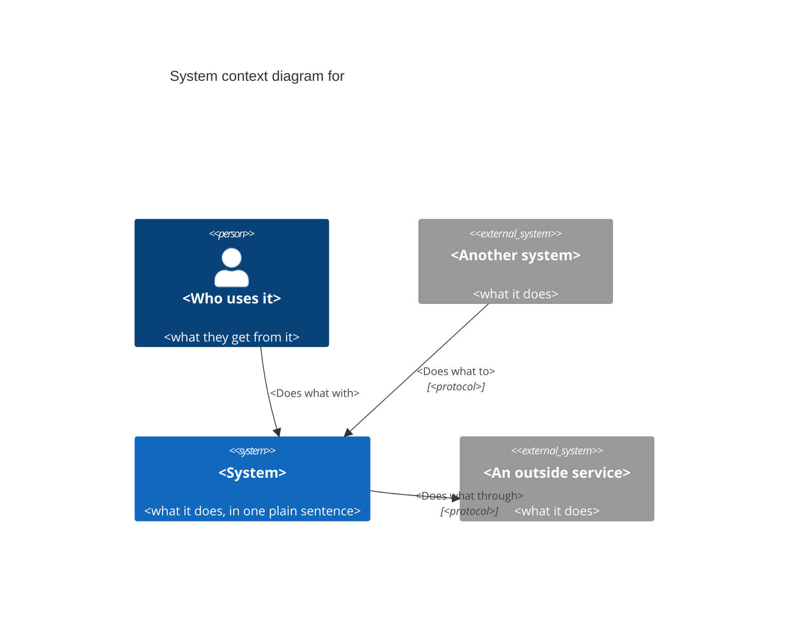
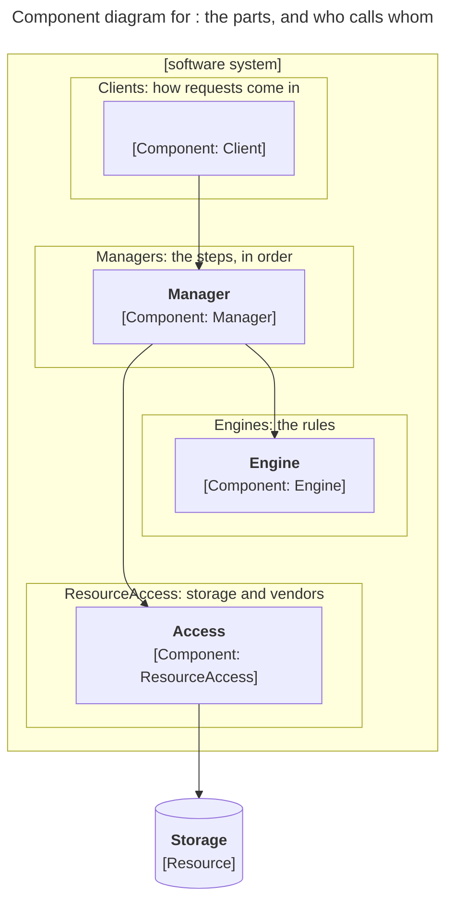

# Design: <system or subsystem name>

**Mode:** inception | subsystem of `<host system>` · **Status:** draft | reviewed
**Date:** <YYYY-MM-DD> · **Scope:** <one line: what is inside the walls, and what is not>

> Walls come from volatility (where change is contained). Bricks come from orthogonal
> primitives (how features are assembled). Each component below traces to a volatility
> (V-id). Each brick traces to a volatility or a current feature (F-id). The design cut
> each item that traces to neither.

## 1. Frame: what this is and who it is for

- **Problem:** <what this system does, in two sentences>
- **Users:** <who uses it, and who calls it: people, systems, schedules>
- **Nature of the business:** <what will not change while this system exists. The design
  deliberately does NOT put a wall around these things.>
- **Constraints:** <deadlines, team, platform, compliance, host-system conventions>
- **Host system (subsystem mode):** <language, framework, where it attaches, owners>
- **Assumptions** (each one replaces a question to the user, and each one is a question
  to confirm):
  - <assumption>. If wrong: <what changes in the design>.



Key: the blue box is the system that we design. Grey boxes are other systems. Figures are
people. Arrows show who calls whom. (See `c4.md`.)

### Words used here

Give one line for each technical word that this document uses. Give the meaning of the
word in plain words (see `writing-guidelines.md`). For example:

- **Volatility**: how likely something is to change.
- **Manager**: the part that runs the steps of a task in order.

## 2. Features and use cases: what it must do

| ID | Feature (as the user would say it) | Core use case? |
|----|--------------------------------------|----------------|
| F1 | <...> | yes |
| F2 | <...> | no — variation of F1 |

Core use cases (the few that carry the essence of the system). Each other use case is a
variation of a core use case:

- UC1: <one line>
- UC2: <one line>

## 3. Volatility register: what is likely to change

| ID | What changes | Axis | Evidence | Likelihood | Contained by |
|----|--------------|------|----------|------------|--------------|
| V1 | <for example, which channels exist, and which vendor delivers each> | over time / across customers | <interview, roadmap, git hotspot, ticket> | high / med / low | <component, plus each new part that the exceptions of the change simulation allow, for example a new ResourceAccess> |

**Rejected candidates** (the design considered these candidates, and deliberately put no
wall around them):

| Candidate | Why not a wall |
|-----------|----------------|
| <...> | variable, not volatile: data or parameters inside one component handle it |
| <...> | nature of the business: if this changes, it is a different system |
| <...> | speculative: no evidence that it will change |

## 4. Walls: the parts, and who can call whom

Draw a C4 component diagram, with one band for each layer (see `c4.md`). If there are
three parts or fewer, do not draw the diagram, because the table below says the same
thing.



Key: light blue is a part that we build. Dark blue is storage. Grey is another system.
Arrows are calls, labelled with the verbs that the calls use. The diagram does not show
Utilities, because every part can call them.

| Component | Type | Encapsulates | API (business verbs) | May call |
|-----------|------|--------------|---------------------------|----------|
| <Client> | Client | V1 (who calls, and how) | entry points: `<Verb>`: `POST /route`, a command, a screen, or a user action (`ClickCell`) | one Manager for each use case |
| <Noun>Manager | Manager | V2 (workflow order) | `<Verb>(...)` | Engines, Access, Utilities. Other Managers only through a queue |
| <Utility> | Utility | <what it does, for example who is signed in, and what they can do> | `<Verb>(...)` | nothing |

For a Client, the API column lists its entry points (routes, commands, screens, or the
user actions that a UI handles). Thus, the blueprint types the entry points, and does not
invent them. Add a Utility row only for a Utility that this system builds (a security
policy). Off-the-shelf logging needs no row.

## 5. Bricks: the small pieces inside each part

Shared contracts (one for each wall, or one that the walls on the same flow share):

- `<Name>` used by <components>: <fields, which bricks can set each field, invariants>

How the pieces are joined (the composition medium): <in code, a pipeline definition, a
state-machine table, or config>. Why: <reason>.

### <Component name>

| Brick | Kind | Does exactly one thing | In → Out | Serves |
|-------|------|------------------------|----------|--------|
| <Render> | Transform | <fills a template for a locale> | Envelope → Envelope | F1, F3, V3 |

State machines (if any). Give each state machine a row in the table above, with Kind
`State machine`. Draw each state machine under its name. Draw only the legal transitions.
The system refuses each transition that the drawing does not show. Mark the terminal
states, if there are any.

```
<Machine>:
  <state> --event [guard] / effect--> <state>
  terminal: <states, or none>
```

## 6. Feature assembly: each feature built from the pieces

Write each feature, current and plausible future, as a composition of existing bricks.

| Feature | Composition | New bricks needed |
|---------|-------------|-------------------|
| F1 | `<Input> → <Transform> → <Transport>` | 0 |
| future: <V1 happens> | `<same, one brick swapped>` | 1 (inside <component>) |

## 7. Validation: proof the design holds

**Use-case walkthroughs** (each core use case as a call chain, with one call on each
line). Start with who the caller is, and how the system knows the caller (a sign-in, an
API key, a card):

```
UC1 <name>: <who calls>, known by <how>
  <Client>        → <Noun>Manager.<Verb>
  <Noun>Manager   → <Noun>Engine.<Verb>
  <Noun>Engine    → <Noun>Access.<Verb>
  <Noun>Manager   → <Noun>Access.<Verb>
```

Result: <pass, or which rule broke and how the walls changed>

**Change simulation** (each volatility as a change that happens. The target is one
existing component touched):

| Volatility | Components that must change | Result |
|------------|-----------------------------|--------|
| V1 | <Component> | pass |

A new ResourceAccess for a genuinely new resource is not a leak. A Client change for a
new human step is not a leak. Write each of these in the Result column.

**Independence check:** <for each brick whose requirement can change a lot: what else
would change. Each answer other than "nothing", and how you fixed it>

**Rule audit:** <call rules, naming, sizing, the smells that you found, and how you fixed
them>

**Trace audit:** <each component without a V-id, each brick without an F-id or a V-id,
and what you did with it>

**Measured coupling (subsystem mode):** <the component pairs from volatility.py above 30%
that a wall now separates, and why the design removes that coupling>

**Cut list:** <the walls or bricks that you considered and removed, because nothing traced
to them>

**Revisions during validation:** <each failed check, the change that you made, and the
result when you ran the check again. For example: "V3 touched RenderingEngine and
PracticeApp; moved template choice into RenderingEngine; re-run passes">

## 8. Seams and migration: how it joins the existing system (subsystem mode)

In inception mode, write "Not applicable: inception", and keep the number.

- **Attach point:** <the seam in the host where the subsystem attaches>
- **Translation at the seam:** <an anti-corruption layer where the subsystem calls the
  host. An open-host service where the host calls the subsystem. Host types stop here>
- **Steps** (each step can ship alone. Delete the old path last):
  1. <put an abstraction in front of the existing behaviour (branch by abstraction)>
  2. <route the callers through the abstraction>
  3. <build the new implementation behind the abstraction>
  4. <change to the new path, observe, and delete the old path>

## 9. Risks and open questions

- <the riskiest assumption in this design, and the cheapest way to test it first>
- <open question>. Who decides: <a person or role>.

## 10. Next steps

- `/argue` this document to find contradictions.
- `/blueprint` to turn this document into an agent-ready spec: typed contracts, state
  machines, signatures, and Gherkin scenarios.
- `/quiz-plan` to turn the walls and the migration steps into an executable change plan.
