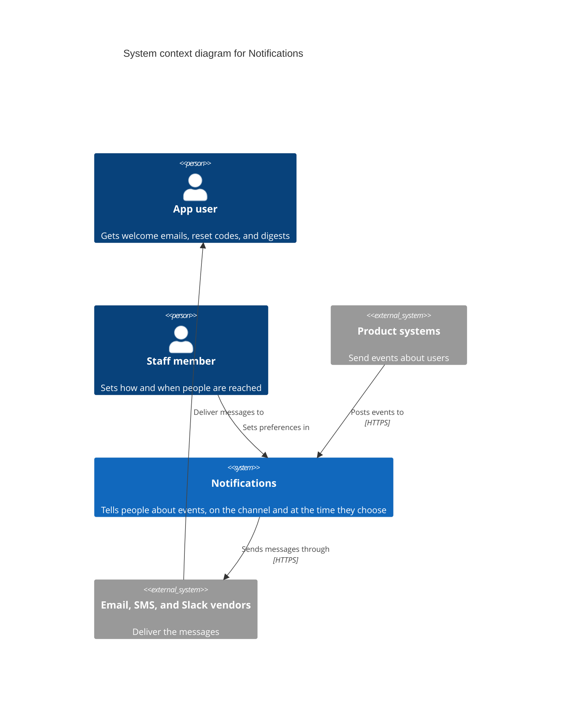
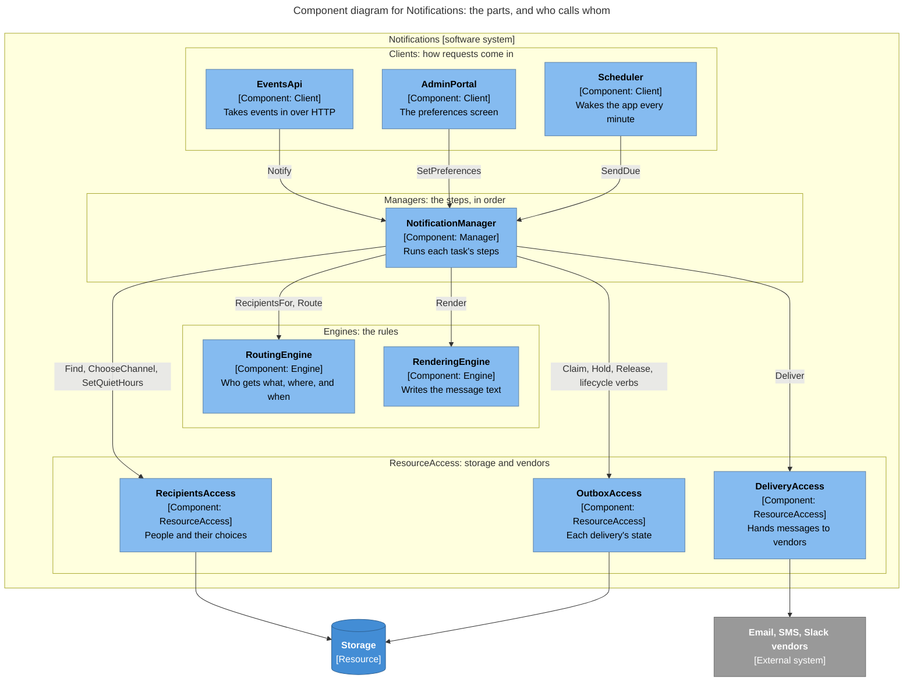
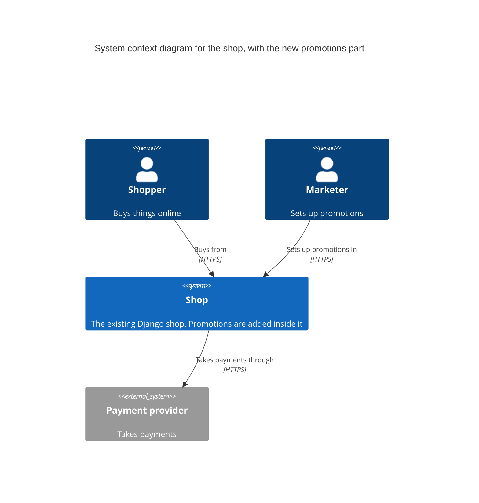

# Worked examples

This file gives two short runs of the method. Try to write a design the way that each run
reads: in plain English, with each name kept exact. The first run starts from a list of
features. The second run adds a new part to a shop that already exists. There, we
measure what changes, and we do not guess.

---

## Example 1 — Inception: a notifications service

The finished document of this example is `notifications.design.md`. Keep the two files the same.

**Features**

| ID | Feature |
|----|---------|
| F1 | A welcome email when someone signs up |
| F2 | A password-reset code by SMS |
| F3 | A daily email that sums up activity (the digest) |
| F4 | Alerts for the operations team, posted to Slack |
| F5 | Each person picks the channel they prefer |
| F6 | Quiet hours: nothing that can wait is sent at night |
| F7 | If sending fails, try again |
| F8 | Messages in each person's language |

**Words used here**

- **Volatility**: how likely something is to change.
- **Wall**: the edge of a part. Usually, a change inside a part does not reach past
  its wall.
- **Client, Manager, Engine, ResourceAccess**: the four kinds of part. A Client takes
  requests in. A Manager runs the steps of a task in order. An Engine applies rules. A
  ResourceAccess part talks to storage or an outside service.
- **Brick**: a small piece inside a part that does one job.
- **Envelope**: the record that carries one message through the steps.

**System context**



Key: the blue box is the system that we design. Grey boxes are other systems. Figures are
people. Arrows show who calls whom.

**The trap.** The obvious design makes one service for each feature:
`WelcomeEmailService`, `DigestService`, `SlackAlertService`, `RetryService`. Each of these
services repeats the same work: pick a channel, write the message, send it, and remember
it. Then, to add WhatsApp, you change each of these services.

**Core use cases.** The eight features are really three tasks:

- UC1: tell people about an event now (F1, F2, F4, F7, F8).
- UC2: tell people about many events later, in one digest (F3).
- UC3: people choose how and when they are reached (F5, F6).

**Nature of the business** (no wall goes around it): the system tells people about
events. Each message has a person and some content. If these facts stop being true, the
system is a different system.

**What is likely to change (volatility register)**

| ID | What changes | Changes over time, or between customers? | Kept inside |
|----|--------------|------------------------------------------|-------------|
| V1 | Which channels exist, and which company delivers each | over time | `DeliveryAccess` |
| V2 | Who gets what, and when: preferences, quiet hours, opt-outs, local rules | between customers | `RoutingEngine` |
| V3 | What messages say: templates and languages | over time | `RenderingEngine` |
| V4 | The steps: send now, send later in a digest, or escalate if unread | over time | `NotificationManager` |
| V5 | Where recipient data lives (our database today, another system later) | over time | `RecipientsAccess` |

Ruled out:

- *The number of retries*: only a setting, not a wall.
- *Fax*: no sign that anyone wants it.
- *Stop telling people things*: that is the nature of the business.

**Walls: the parts, and who is permitted to call whom**



Key: light blue is a part that we build, dark blue is storage, and grey is another
system. Bands run from top to bottom: Clients, Managers, Engines, ResourceAccess. Arrows
are calls, labelled with the verbs that the calls use. No arrow goes up or sideways. The
diagram does not show Utilities (logging, secrets, pub/sub), because each part is
permitted to call them.

| Component | Type | API (business verbs) | Calls |
|-----------|------|----------------------|-------|
| `EventsApi` | Client | `Receive`: `POST /events` | `NotificationManager` only |
| `AdminPortal` | Client | `SavePreferences`: the preferences screen | `NotificationManager` only |
| `Scheduler` | Client | `OnTick`: every minute | `NotificationManager` only |
| `NotificationManager` | Manager | `Notify`, `SendDue`, `SetPreferences` | `RoutingEngine`, `RenderingEngine`, `RecipientsAccess`, `DeliveryAccess`, `OutboxAccess` |
| `RoutingEngine` | Engine | `RecipientsFor`, `Route` | nothing: the Manager finds the people and passes them in |
| `RenderingEngine` | Engine | `Render` | nothing: templates ship with it as files |
| `RecipientsAccess` | ResourceAccess | `Find`, `ChooseChannel`, `SetQuietHours` | storage |
| `DeliveryAccess` | ResourceAccess | `Deliver` | email, SMS, and Slack vendors |
| `OutboxAccess` | ResourceAccess | `Claim`, `Hold`, `Release`, `DueRetries`, `StartAttempt`, `FailAttempt`, `ScheduleRetry`, `GiveUp`, `ConfirmDelivery` | storage |

- `Scheduler` is also a client: time is only one more caller. `SendDue` sends the held
  digest items, and wakes the retries that are due.
- `NotificationManager` is the only part that knows the order of the steps.
- Because we retry, the system could send a message two times. `OutboxAccess.Claim`
  stops a second send: the system sends each (event, person, channel) only one time.
- A delivery's life is a set of business verbs (`StartAttempt`, `FailAttempt`,
  `ScheduleRetry`, `GiveUp`, `ConfirmDelivery`), not one "set the state" call.
- `OutboxAccess` has no row in the register. `OutboxAccess` hides our own storage, and
  that reason is sufficient alone.

**Size check.** The design has two differences from Löwy's usual sizes. Both differences
are on purpose:

- One Manager, where Löwy usually sees two to five. This service has one family of tasks.
- Two Engines for one Manager, one more than the usual ratio of Löwy. Routing rules and
  message text change for different reasons, and different people own them. If we join
  the two Engines, two likely changes go behind one wall.

**Bricks: the small pieces inside each part**

The shared contract is `Envelope`: the record that carries one message through the steps.

- `Envelope` used by `NotificationManager`, `RoutingEngine`, `RenderingEngine`,
  `DeliveryAccess`: `{ eventId, eventType, recipientId, urgency, channel?, locale?, body?, data }`.
  The tries and the receipts belong to the delivery, and `OutboxAccess` keeps the
  delivery.

Inputs make envelopes. Transforms and policies take one envelope and give one envelope
back (a policy is permitted to give back none or several). Transports send the envelopes
out of the system. Thus, any Transform can follow any other Transform.

| Component | Bricks | Kind |
|-----------|--------|------|
| EventsApi | `OnEvent(type)`: other systems post events to it over HTTP | Input |
| Scheduler | `OnSchedule(cron)` | Input |
| NotificationManager | `Delivery`: pending → sending → delivered, or sending → failed → retrying → sending, or failed → dead | State machine |
| RoutingEngine | `Expand` (event → people), `Prefer`, `QuietHours` | Transform (policy) |
| RenderingEngine | `Render(template, locale)` | Transform |
| DeliveryAccess | `Email`, `Sms`, `Slack`, each `send(envelope) → receipt` | Transport |
| OutboxAccess | `Hold(key, window)`, `Release(due)` | Store |

- The other job of the Manager is the wiring: one flow for each task. Each flow calls the
  pieces above through the verbs of each part.
- Flows are plain code for now. The flows are the same for each customer, and no flow
  runs for a long time. The digest is two short flows, and `OutboxAccess` keeps the held
  items.
- "Escalate if unread" (V4, a change to the steps) would be a long-running flow. If this
  flow comes, store the flows, and run them with a workflow tool, as Löwy does.
- Routing policies are an ordered list for each customer.

Why each brick earns its place:

- `Expand`, `Prefer`, `QuietHours`, `Render`, `Email`, `OnEvent`, and `Delivery` each
  serve two or more features.
- `Sms`, `Slack`, `Hold`, and `Release` serve one feature each. Each of these bricks is
  one of the choices that a recorded change names: a channel in V1 (channels and
  vendors), the digest in V4 (the steps).
- `OnEvent` and `OnSchedule` are Inputs, the way in, so they need no other reason.

Cut: a `Webhook` transport and an `OptOut` policy. No feature needs these bricks today,
and no recorded change names them. If a feature needs one of these bricks later, the
change is one new brick in one part.

**Feature assembly: each feature built from the pieces**

| Feature | How it's built | New bricks |
|---------|----------------|------------|
| F1 | `OnEvent(user.created) → Route → Render(welcome) → Deliver` | 0 |
| F2 | `OnEvent(password.reset) → Route[channel=sms] → Render(reset) → Deliver` | 0 |
| F3 | `OnEvent(activity.*) → Route → Hold(daily)` then `OnSchedule(08:00 local) → Release → Render(digest) → Deliver` | 0 |
| F4 | `OnEvent(alert.*) → Route[team] → Render(alert) → Deliver` | 0 |
| F5, F6 | `Prefer` and `QuietHours` inside `Route` | 0 |
| F7 | the `Delivery` state machine | 0 |
| F8 | `Render`'s locale argument | 0 |
| future: WhatsApp (V1) | a `WhatsApp` transport in `DeliveryAccess` | 1 |
| future: escalate if unread in 15 min (V4) | `… → Deliver(push) → Wait(15m, unless read) → Deliver(sms)` | 1 (`Wait`, in the Manager) |
| future: no SMS to EU users at night (V2) | a policy in `RoutingEngine` | 1 |

**Change simulation: if each change happens, what must change?**

| The change | Parts that change | Result |
|------------|-------------------|--------|
| V1: add WhatsApp, or switch SMS company | `DeliveryAccess` | pass |
| V2: a new local rule | `RoutingEngine` | pass |
| V3: a new template or language | `RenderingEngine` (files only) | pass |
| V4: escalate if unread | `NotificationManager` (one new flow, one new `Wait` step) | pass |
| V5: recipients move to another system | `RecipientsAccess` | pass |

**Use-case walkthroughs: each task, call by call**

```
UC1 tell people about an event now: a product system, known by its API key
  EventsApi           → NotificationManager.Notify
  NotificationManager → RoutingEngine.RecipientsFor
  NotificationManager → RecipientsAccess.Find
  NotificationManager → RoutingEngine.Route
  NotificationManager → OutboxAccess.Claim
  NotificationManager → RenderingEngine.Render
  NotificationManager → OutboxAccess.StartAttempt
  NotificationManager → DeliveryAccess.Deliver
  NotificationManager → OutboxAccess.ConfirmDelivery

UC2 tell people about many events later: a product system, then the app's own timer
  EventsApi           → NotificationManager.Notify        (ends by holding the item)
  NotificationManager → RoutingEngine.RecipientsFor
  NotificationManager → RecipientsAccess.Find
  NotificationManager → RoutingEngine.Route
  NotificationManager → OutboxAccess.Claim
  NotificationManager → OutboxAccess.Hold
  Scheduler           → NotificationManager.SendDue
  NotificationManager → OutboxAccess.Release
  NotificationManager → RenderingEngine.Render
  NotificationManager → OutboxAccess.StartAttempt
  NotificationManager → DeliveryAccess.Deliver
  NotificationManager → OutboxAccess.ConfirmDelivery

UC3 choose how and when to be reached: a staff member, known by the company sign-in
  AdminPortal         → NotificationManager.SetPreferences
  NotificationManager → RecipientsAccess.ChooseChannel
  NotificationManager → RecipientsAccess.SetQuietHours
```

The tasks need no new part. No call goes up or sideways, and each task uses one Manager.
Pass.

---

## Example 2 — Subsystem: promotions in a shop that already exists

**Request:** "Add promotions (percent off, staff discount, 3-for-2) to our Django shop."

**Words used here**

- **Seam**: the place where the new part joins the existing code.
- **Coupling**: how often two parts change together.
- **Branch by abstraction**: put a stand-in in front of old code. Move all the calls to
  the stand-in. Then swap the code behind the stand-in.

**System context**



Key: the blue box is the shop that we change. Grey is another system. Figures are people.

**Measure first.**

```
python volatility.py --path shop --depth 1 --since "18 months ago"
```

| component | commits | days since change |
|-----------|---------|-------------------|
| shop/checkout | 140 | 2 |
| shop/cart | 95 | 5 |
| shop/catalog | 60 | 11 |
| shop/payments | 20 | 94 |

- `shop/cart` and `shop/checkout` change together in 62% of their commits.
- The busiest large files are `checkout/totals.py` (58 commits, 900 lines) and
  `cart/pricing.py` (41 commits).
- The commit messages of these files say "black friday 20% off", "staff discount", "fix
  rounding on bundle", and "NZ GST change".

**What the numbers say.** The price rules are the part that changes again and again. The
price rules are in two files. Thus, cart and checkout change together again and again.
The checkout *steps* do not change much (`checkout/flow.py`: 4 commits in 18 months).
Thus, the checkout steps need no new wall.

**What is likely to change (volatility register)**

| ID | What changes | Evidence | Kept inside |
|----|--------------|----------|-------------|
| V1 | Price rules: promotions, staff and bundle discounts | busy files and commit messages | `PricingEngine` (new) |
| V2 | Where promotions are set up (the admin today, a marketing tool later) | the roadmap | `PromotionsAccess` (new) |
| V3 | Tax rules in each region | commit messages | not now, but the next candidate |

Ruled out:

- *Rounding rules*: only a setting for each currency.
- *The order of checkout steps*: the numbers show that the order is stable.

**Walls, for the new part only.** The cart and the checkout of the shop continue to act
as Managers. They own the steps, and the steps are stable. Two parts are new:

| Component | Type | API |
|-----------|------|-----|
| `PricingEngine` | Engine | `Quote(basket) → quote` |
| `PromotionsAccess` | ResourceAccess | `ActivePromotions(at)`, `Define(promotion)` |

There are only two new parts, so the table says it all. Thus, there is no component
diagram. C4 says: draw a diagram only when it adds something.

**Where it joins the shop (the seam).**

- The seam is the existing `compute_total(cart)` in `checkout/totals.py`. Cart and
  checkout both call this function already.
- `PricingEngine` offers one API in its own words (`Basket`, `Quote`). Evans calls this
  kind of API an open-host service.
- `compute_total` becomes one line. The line turns the shop's `Cart` into a `Basket`
  (SKU, category, quantity, unit price, customer group), and asks for a quote.
- The translation from `Cart` to `Basket` is on the shop's side of the seam. Changes to
  the Django models stop at the seam.
- If the engine needs more from the shop at a later time, the engine reads through a
  ResourceAccess part over the shop. The engine does not import Django models.

```
checkout            → compute_total(cart)        seam: turn Cart into Basket
compute_total       → PricingEngine.Quote
PricingEngine       → PromotionsAccess.ActivePromotions
```

**Bricks inside PricingEngine.**

- `Quote` used by `PricingEngine`: `{ lines[], adjustments[], total }`.

| Brick | Kind | Its one job |
|-------|------|-------------|
| `Match(condition)` | Transform (policy) | picks the lines a promotion applies to: by SKU, category, customer group, or dates |
| `PercentOff(n)`, `FixedPrice(x)`, `CheapestFree` | Transform | each adds one kind of discount to the picked lines |
| `BestOf`, `Exclusive` | Transform (policy) | decide which promotions win when several apply |
| `Round(currency)` | Transform | rounds once, at the end |

- A promotion is data: `{match, adjustment}`.
- The engine runs each active promotion. Then the engine runs the rule that chooses the
  winners (`BestOf`, unless a promotion is `Exclusive`). Then the engine runs `Round`.
- The first draft had one `Adjust(kind)` brick. The `kind` setting of that brick switched
  between three different sums. A switch like this is a smell, so the brick became three
  bricks.
- `Match(condition)` stays one brick. The condition of `Match` is a test that the same
  code runs. The condition is not a switch between behaviours.
- Cut: `AmountOff`, a `Limit` for each order or for each customer, and a `Sequential` rule
  that chooses winners. No feature needs these bricks today.
- `FixedPrice`, `CheapestFree`, and `Exclusive` serve one feature each. Each of these
  bricks is a kind of price rule that V1 (price rules) names.

**Feature assembly**

| Feature | How it's built | New bricks |
|---------|----------------|------------|
| 20% off a category | `Match(category=x) → PercentOff(20)` | 0 |
| Staff discount | `Match(group=staff) → PercentOff(30)`, marked `Exclusive` | 0 |
| 3-for-2 | `Match(sku in set, qty ≥ 3) → CheapestFree` | 0 |
| The existing bundle price (moved from shop code) | `Match(sku in bundle) → FixedPrice(x)` | 0 |
| future: $10 off orders over $100 (V1) | `Match(order_total ≥ 100) → AmountOff(10)` | 1 (`AmountOff`, inside `PricingEngine`) |

**Moving over** (each step can ship alone):

1. Lock today's totals in tests over real baskets.
2. Put `PricingEngine.quote(basket)` in front of the current sums, unchanged. This step is
   "branch by abstraction".
3. Send both cart and checkout through `PricingEngine`. After this step, there are no
   duplicate sums.
4. Build each current discount again as promotion data, one at a time, behind a switch.
   Run the old code and the new code side by side. Compare the quotes before you change
   to the new code.
5. Delete the old code.

**Proof.**

- A new kind of promotion changes `PricingEngine` only.
- If promotion setup moves to a marketing tool, only `PromotionsAccess` changes.
- Three months after the switch, run `volatility.py` on only those three months
  (`--since <switch date>`). Also run `volatility.py` on the three months before the work
  started (`--since … --until …`).
- Expect `cart ↔ checkout` to change together much less than 62% now. The bar that the
  skill suggests is under 30%. Below 30%, the report does not list the pair.
- A longer window would count mostly old commits, and would still show the old number.
- If the number did not fall, the wall leaks, and the design needs another look.
